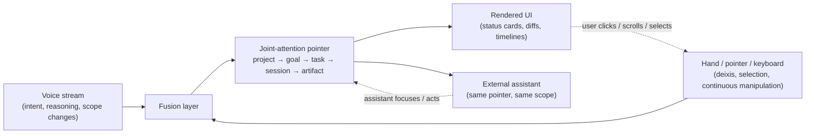
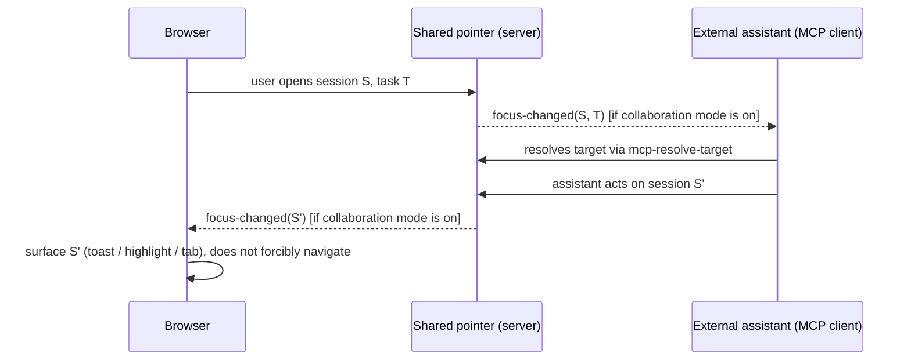

# Agent-native, semantic Web UI for high-information-density software engineering — a design discussion

Status: Discussion / exploratory. No decisions are being asked for and no product code changes
accompany this document. It exists to give a shared vocabulary and a set of concrete, falsifiable
experiments to a longer-running conversation about where CloudCLI's interaction model goes once
an external conversational assistant is a first-class user of the same UI a human drives.

Date: 2026-10-06

Relations:

- Builds on `docs/proposals/mcp-gateway-SPEC.md` — the existing MCP control plane
  (`ChatControlService`, `server/modules/mcp-gateway/*`) is the closest thing this repo has today
  to a "semantic interface instead of pixels," and is used throughout as the running example of
  what already works and what it's missing.
- Builds on `docs/proposals/claude-session-activity-dock.md` — the activity dock is this repo's
  first serious attempt at "visualization as compression channel" (§4 there: status cards, phase
  model, heartbeat/freshness). This document treats it as the kernel of a general status-card
  language, not a one-off widget.
- Builds on `docs/proposals/voice-kit-SPEC.md` for the voice capture/ASR architecture that
  persistent voice would sit on top of.
- Relevant existing surfaces cited below, by path, no line numbers (symbols move, paths are more
  stable, grep for the rest): `src/modules/command-palette/*`, `src/modules/quay/*` +
  `goals/`, `tasks/`, `milestones/` at repo root, `src/modules/project-workspace/*`,
  `src/shared/context/WebSocketContext.tsx`, `server/modules/mcp-gateway/mcp-resolve-target.ts`,
  `server/modules/mcp-gateway/mcp-approvals.ts`, `src/modules/git-panel/*`,
  `src/modules/browser-use/*` + `server/modules/browser-use/browser-use-mcp.ts`.
- Everything below is a discussion position, not a verified fact about the codebase, unless it
  cites a specific file. Where it extrapolates past what's implemented, it says so.

---

## 0. Why this is being written now

CloudCLI already has, in nucleus form, every layer of the hierarchy this document is about —
just not wired into one cross-cutting pointer, and not exposed uniformly to both a human clicking
and an agent calling tools:

| Layer | Exists today as | Where |
|---|---|---|
| Project | Folder-scoped workspace, selected in sidebar | `src/modules/project-workspace/context/ProjectsStateContext.tsx` |
| Goal / Task | The *dev-loop's own* goal→task graph (quay driving work on this repo) | `goals/`, `tasks/`, `milestones/` at repo root, rendered by `src/modules/quay/QuayPanel.tsx`, `TimelineBar.tsx` |
| Session / Run | Chat session, resident or per-run; every turn gets a `runId` | `chatRunRegistry`, `SessionHostManager` (see `docs/proposals/mcp-gateway-SPEC.md` §现状) |
| Artifact / Diff | File tree, git diff/stage/commit | `src/modules/git-panel/*`, `src/modules/file-tree/*` |
| Approval | Tool-use permission prompts, now machine-addressable | `server/modules/mcp-gateway/mcp-approvals.ts`, `chat.permission-response` |
| Semantic action surface (embryonic) | A flattened, searchable list of sessions/branches/commits/files/git-actions, invoked without navigating a GUI tree | `src/modules/command-palette/*` |
| Agent-addressable control plane | A provider-neutral MCP server that can list, read, send, abort, cancel-queued, and resolve a target session — exactly the "semantic interface instead of reverse-engineered pixels" this document argues for | `server/modules/mcp-gateway/*` (`mcp-resolve-target.ts`, `mcp-session-send.ts`, `mcp-gateway.read-tools.ts`, `mcp-gateway.write-tools.ts`) |
| Agent driving a UI-shaped surface via its own MCP | `src/modules/browser-use/BrowserUsePanel.tsx` is a panel *and* `server/modules/browser-use/browser-use-mcp.ts` exposes the same capability as MCP tools | `server/modules/browser-use/browser-use-mcp.ts` |

That last row is worth pausing on: this codebase already has one module (`browser-use`) where a
human-facing panel and an agent-facing MCP tool set are two views onto the same capability, built
by the same team, in the same PR shape. That's the pattern this document wants to generalize, not
invent.

What's genuinely missing is cross-layer and bidirectional: `mcp-resolve-target.ts` resolves *a
session* for an incoming MCP call, but there's no pointer that also carries goal/task and
artifact context, and nothing pushes the resolved target back out to a human's open browser tab so
they see where the agent's attention is. The rest of this document is organized around that gap.

---

## 1. Core thesis and principles

1. **Information density beats pointing precision as the bottleneck.** A click says "this one
   thing, here." A sentence says "this change, because X, watch for Y, unless Z." Software
   engineering conversations are mostly the second kind of statement; conventional GUIs force them
   through the first kind of channel. Voice (or any high-bandwidth text/agent channel) should
   carry intent and reasoning; pointing devices should carry *reference*, not *meaning*.

2. **Voice and hands are complementary, not competing.** Voice is bad at deixis ("that one," "the
   third row," "this hunk") and bad at continuous manipulation (scrolling, dragging a diff view).
   Hands/mouse/keyboard are bad at expressing why or at describing a graph-shaped plan. The
   combination — point with a hand, narrate with voice, let the system fuse the two — is strictly
   more expressive than either alone. This is not a new idea (it's the "put-that-there" line of
   HCI research going back to Bolt 1980), but it has not been applied to a software-engineering
   control surface with the kind of joint-attention state this repo already half-has.

3. **Agents are first-class UI clients, not back-channel automation.** If CloudCLI already lets an
   external MCP client send, abort, and inspect a session (it does — see `mcp-gateway-SPEC.md`),
   then an agent reading the DOM and clicking a button to accomplish the same thing is a
   regression, not a stopgap. Every capability a human reaches through a button should have a
   semantic, documented, machine-callable twin; the button becomes one *projection* of the
   affordance, not its definition.

4. **Visualization is a compression channel, not a human nicety.** A goal→task graph, a diff, a
   timeline, a status card render structure that would take paragraphs to describe in prose and
   take a human seconds to parse. An agent-native UI should treat rendering *to the human* and
   serializing *to the agent* as two encodings of the same underlying structured state — not
   regenerate one from the other by screen-scraping.

5. **The pointer is the primitive.** A single, shared, structured "where are we" value —
   project → goal → task → session → artifact/diff/approval — is what makes voice-plus-hands,
   agent-plus-human, and browser-plus-assistant cooperation all the same mechanism instead of three
   bespoke integrations. Get the pointer right and most of the rest (discoverability, safety,
   accessibility) becomes "what can you do with the thing the pointer names," asked uniformly.

6. **Buttons are a rendering of state, not the API.** The provocative claim in the prompt — "many
   buttons may disappear as mandatory physical controls" — follows directly from (3) and (6): if
   the affordance is defined machine-readably and voice/agent/keyboard/direct-manipulation are all
   equally valid ways to invoke it, a visible clickable rectangle is just the fallback renderer for
   users who have no better channel at that moment. It should remain available, legible, and
   complete — not necessarily default or primary.

---

## 2. Interaction model: voice and hands as one input

### 2.1 Mental model



The fusion layer's job is narrow: resolve voice utterances that contain an implicit referent
("revert that hunk," "open the one that's stuck") against whatever the hand/pointer channel most
recently selected, and resolve hand actions that need narration ("why is this red") against the
voice channel's running context. It does **not** need to be a general multimodal model from day
one — a timestamped selection buffer plus a short voice transcript window, cross-referenced by a
simple recency/overlap heuristic, covers most of the "put-that-there" cases this document cares
about. Get the plumbing (one shared pointer, two writers) right before trying to get the fusion
heuristic clever.

### 2.2 What each channel is good at, concretely, in this codebase

| Task | Natural channel | Why |
|---|---|---|
| "Why did this session stall" | Voice (open question, needs reasoning over activity-dock state) | Requires synthesizing `paused`/freshness/lease state (`claude-session-activity-dock.md` §1.4, §4.4), not pointing at one field |
| "Approve this one" (a pending tool-use permission) | Hand/click, or voice + current pointer | Deictic, binary, already addressable by id via `mcp-approvals.ts` |
| "Switch to the quay goal about the activity dock" | Voice | Natural-language search over `goals/`/`tasks/` is cheaper to say than to navigate a tree for |
| Scrolling a long diff, resizing panes, dragging the sidebar | Hand | Continuous manipulation; voice is a poor fit even with perfect ASR |
| "Send this to the resident session, not a new one" | Either — but the choice of *target* should resolve through the same pointer `mcp-resolve-target.ts` already uses server-side | Keeps human-initiated and agent-initiated sends consistent |

### 2.3 Near-term vs. long-term

- **Near-term**: voice stays a dictation input into the composer (what `voice-kit-SPEC.md`
  describes), but the transcript is tagged with "what was focused when this was said" — the
  existing selection state (open session id, open file, selected diff hunk) — so a downstream
  agent reading the message has the deictic referent even without a fusion layer.
- **Long-term**: a standing voice channel that is not bound to the composer textbox at all (see
  §5), fused against whatever the pointer (§4) currently names, with the fusion resolved
  server-side so the same resolution logic serves both a human's spoken "that one" and an agent's
  tool call that says `target: "current"`.

---

## 3. Semantic affordance / API model

### 3.1 The shape of an affordance

For a capability to be agent-native, it needs four things that a button alone doesn't provide:

1. **A stable identifier** independent of its visual rendering (not "the second button in the
   third card").
2. **A machine-readable precondition/postcondition** — is it available now, what does invoking it
   change. `mcp-gateway.read-tools.ts` vs `mcp-gateway.write-tools.ts` already draws exactly this
   line at the module level (read tools can't change state; write tools can and are audited —
   `mcp-gateway.audit.ts`).
3. **A human-legible label and an agent-legible schema for the same action**, generated from one
   source so they cannot drift (today: a button's `aria-label`/tooltip and an MCP tool's
   `description` are authored independently and can say different things about the same action —
   this is the concrete drift risk worth designing against, not a hypothetical one).
4. **A scope**: which pointer level it operates at (session-level abort vs. task-level retreat vs.
   project-level settings change), so "what can I do right now" can be answered by walking the
   pointer outward from the current focus instead of grepping a global action list.

### 3.2 A minimal registry, not a new protocol

This does not require inventing a new IDL. The practical path is: define affordances once, in a
form that can render (a) a button/menu entry, (b) an MCP tool, and (c) a command-palette entry,
from the same declaration. `src/modules/command-palette/hooks/useGitActions.ts` and
`server/modules/mcp-gateway/mcp-gateway.write-tools.ts` already express overlapping actions (git
operations, session control) twice, by hand, in two different shapes. A shared affordance
declaration — ideally just a typed object with `{id, scope, precondition, invoke, humanLabel,
agentSchema}` — that both the palette and the MCP tool list consume removes that duplication and
makes the "every button has a semantic twin" principle structurally true instead of a code-review
norm.

### 3.3 What should *not* be collapsed into tool calls

Not every UI interaction is an affordance worth exposing to an agent. Pure layout/ergonomics
(resizing a pane, dark mode, scroll position) has no semantic content — exposing it as an MCP tool
would just be surface area to secure and maintain for no joint-attention benefit. The filter: does
a reasonable external agent ever have a legitimate reason to invoke this on the user's behalf? If
not, it stays a plain UI control with no agent twin, and that's fine — not everything needs to be
agent-native.

---

## 4. Joint attention: the shared pointer and context synchronization

### 4.1 What the pointer is

A single structured value, held server-side (not just in a browser tab, since the assistant may be
external and the browser may be closed):

```
{
  projectId,
  goalId?,      // quay goal, when the focus is dev-loop work
  taskId?,
  sessionId?,   // chat session (resident or per-run)
  runId?,       // the specific run within that session, if one is in flight
  artifact?: { kind: "file" | "diff" | "approval", ref: string }
}
```

This is a superset of what `mcp-resolve-target.ts` already resolves for an incoming MCP call
(session-level) and what `ProjectsStateContext.tsx` already holds client-side (project/session
selection). The design move is: make it one object, held in one place addressable by both sides,
instead of two overlapping-but-separate pieces of state that happen to agree most of the time.

### 4.2 Bidirectional synchronization



Two asymmetries matter:

- **Human-opens-X → assistant-informed** should default to a *low-ceremony* read: it's exposing
  "what is this person looking at," not what they're doing — still a privacy-relevant fact,
  addressed in §4.3.
- **Assistant-acts-on-Y → browser-surfaces** should default to *non-disruptive surfacing*
  (a dock entry, a badge, a toast), never an unprompted navigation that yanks focus out from under
  something the human is mid-typing into. This is the same "truthful but not noisy" design
  constraint the activity dock document already worked through for run status
  (`claude-session-activity-dock.md` §4.6, "heartbeat/freshness over cheerful polling").

### 4.3 Collaboration mode and privacy

Bidirectional sync must be opt-in per session/project, not global and not implicit — the
`mcp-gateway-SPEC.md` already treats "no multi-tenant isolation, everything maps to an
authenticated user" as a stated non-goal boundary; pointer-sharing should not quietly widen that.
Concretely: a session is sync-eligible only when both the browser tab and the connected assistant
have the same explicit pairing (e.g., the assistant is the one the user is actively talking to in
*this* conversation, not every PAT-holding MCP client that happens to be connected). Default: off.
A user should be able to answer "is anything outside this browser tab seeing what I'm looking at
right now" without reading code.

### 4.4 Generalizing today's two separate hierarchies

Quay's goal→task graph (the dev loop that maintains *this repository*) and a session/run (a chat
turn) are currently different concepts rendered by different panels (`QuayPanel.tsx` vs. the chat
transcript). The pointer model above treats them as two optional levels of the same chain
precisely because, for a *user* driving their own project through CloudCLI, "what goal is this
session in service of" is a real and useful question whether or not quay is involved — it's
equally sensible to ask it about a manually-run chat session with no quay task behind it (then
`goalId`/`taskId` are simply absent). This is a generalization claim, not an implemented fact:
today only quay-managed work populates goal/task; making the field meaningful for non-quay
sessions is future work, not something to assume already holds.

---

## 5. Persistent voice

### 5.1 Why "persistent," not "per-page"

If voice is bound to a single chat composer, every scope change (switch project, open a diff, look
at the activity dock) either drops the voice context or requires re-establishing it. The thesis in
§1 only holds if voice can narrate across a scope change ("okay, now look at the other session")
without the user re-opening a mic control. The standing-channel model: voice capture is a
browser-wide feature (think: always-available status icon, like the existing composer voice
button's sibling but detached from the composer's lifecycle, not an additional per-component ASR
instance), whose *target* for a given utterance is resolved against the current pointer (§4), not
against whichever React component happens to be mounted.

### 5.2 Scope

- **Session scope**: "do X" resolves against the currently pointed-to session/run.
- **Project scope**: "what's running right now" resolves against all sessions/hosts under the
  current project (this is close to what `GET /api/session-hosts` already returns in aggregate —
  see `mcp-gateway-SPEC.md` §现状).
- **Global scope**: "which project needs me" is explicitly the quay *manager* layer's job today
  (cross-project planning — see the `quay:manager` skill), not a UI feature; a global-scope voice
  query would, at most, be a client to that existing layer, not a reimplementation of it.
  *(2026-10-11 pointer, this bullet unchanged: the cross-project layer is now designed as a
  persistent CloudCLI Manager Agent in `docs/proposals/cloudcli-ai-manager.md`; how it relates to
  the `quay:manager` skill — host vs. reimplementation — is open there as tension T2.)*

Scope should be settable by saying it ("zoom out to the project") as much as by a UI toggle,
because scope changes are themselves intent statements, not navigation.

### 5.3 Near-term vs. long-term

- **Near-term**: keep voice bound to the composer (current architecture), but (a) make the voice
  button's availability consistent across every surface that can accept a chat send, and (b) tag
  every transcript with the pointer value active when capture started, so even today's
  composer-bound voice gets deixis "for free" the moment §4's pointer exists.
- **Long-term**: a detached, standing capture surface with explicit start/stop (never
  always-listening by default — see §7), scope indicator, and a fusion layer per §2.

---

## 6. Discoverability when buttons disappear

The risk in the prompt's "buttons may disappear" claim is real: if an affordance's only expression
becomes an MCP tool description an agent was briefed on, a human without that agent loses the
affordance entirely, and *even the agent* loses it the moment the tool list changes shape or the
agent wasn't told about it. Discoverability has to survive both.

Design commitments, in priority order:

1. **State and available actions are always renderable**, even when the primary invocation path is
   voice/agent. A "what can happen here" view — effectively, rendering the affordance registry
   (§3.2) filtered to the current pointer scope — is the non-negotiable fallback, and it should be
   reachable the same way regardless of input modality (keyboard shortcut, visible menu, voice
   query "what can I do here").
2. **Agents must be able to discover affordances the same way a human would**, not rely on
   out-of-band briefing. This is what MCP's own `tools/list` already gives you structurally; the
   discipline is making sure every affordance a human can reach is actually registered there, not
   a silent UI-only path (the registry in §3.2 is what makes this checkable instead of aspirational).
3. **Absence of a button is not absence of discoverability.** A control surface that shows "state +
   available choices" (a card saying "3 approvals pending, 1 session stalled") is *more*
   discoverable than a toolbar of icons a new user has to hover to decode — this is the
   `claude-session-activity-dock.md` status-card direction, generalized past run status to "here
   is what's true, and here is what you could do about it."

---

## 7. Safety and confirmation boundaries

Concentrating more invocation power into voice/agent channels raises the cost of a
misrecognized utterance or a misaligned agent action. The existing system already has a relevant
split to build on, not invent: `mcp-gateway.read-tools.ts` vs `mcp-gateway.write-tools.ts`, and the
fact that `mcp-gateway-SPEC.md` keeps "remote write file / git commit / push / arbitrary shell" as
an explicit non-goal even for an *authenticated, scoped-token* MCP client.

Proposed boundary classes (discussion-level, not a spec):

| Class | Examples | Confirmation policy |
|---|---|---|
| Read / navigate | Open a session, view a diff, ask "what's running" | None — this is where "buttons disappear" is safest, since nothing changes |
| Reversible write | Send a chat message, abort a run, stage a file | Voice/agent-executable immediately; undo/visible-in-UI is the safety net, matching how a resident session's queued input can already be withdrawn (`cancel_async_message`, per `mcp-gateway-SPEC.md`) |
| Hard-to-reverse | git commit/push, close a session host, merge | Always requires an explicit, unambiguous confirmation step that names the action in full — voice confirmation only counts if the system echoes back exactly what it understood and gets a distinct affirmative, not a continuation of the same utterance |
| Destructive / scope-expanding | Delete a project, grant a new token/scope, change collaboration-mode pairing (§4.3) | Out of voice/agent reach entirely in v1 — hand/keyboard + explicit UI, full stop, independent of how good fusion/ASR gets |

This mirrors, at the UI-affordance level, the same posture this very session's own operating
instructions take toward destructive git operations — "the cost of pausing to confirm is low, the
cost of an unwanted irreversible action is high" generalizes cleanly from an agent's own tool use
to a UI designed for agents and humans to share.

---

## 8. Accessibility and fallback GUI

"Semantic-first" must not become "voice/agent-only." Concrete commitments:

- Every affordance remains reachable through a conventional, static, keyboard-navigable GUI at all
  times — not as a legacy mode kept alive for migration, but as a permanent, independently-tested
  surface. The command palette (`src/modules/command-palette`) already demonstrates that a
  flattened, keyboard/text-searchable action surface can coexist with a conventional GUI without
  the two drifting.
- A text-only fallback (type instead of speak) must use the *same* resolution path as voice — i.e.,
  text input is not a separate, lesser-featured channel, it's voice's transcript with the ASR step
  skipped. This keeps accessibility a side-effect of the architecture rather than a parallel
  feature to maintain.
- Status/attention visualizations (§1 principle 4) need a non-visual encoding (screen-reader
  equivalent, and eventually a spoken-summary equivalent — "three sessions need attention, the
  oldest has been stalled 40 minutes") for users who cannot use the graphical rendering, which is
  also exactly the representation an agent would want read back to it, another case of one
  structure, two renderers.

---

## 9. Relation to MCP and agent protocols

CloudCLI's own MCP gateway is the proof that this document's thesis is already partially validated
in-repo, not purely aspirational:

- `ChatControlService` as a transport-agnostic layer behind both the WebSocket chat gateway and the
  MCP gateway (`mcp-gateway-SPEC.md` D5) *is* "semantic interface instead of reverse-engineered
  pixels," applied today to session control.
- `ChatRunSource` growing an `'mcp'` value (D9) is the concrete mechanism by which the UI can tell
  "a human did this" from "an agent did this" — a prerequisite for both joint-attention surfacing
  (§4) and for differentiated confirmation policy (§7): a write performed by an authenticated MCP
  client should be distinguishable in the UI from the same write performed by the signed-in human,
  so a user reviewing history isn't misled about who did what.
- The affordance registry in §3.2 is this document's proposal for *generalizing* what
  `mcp-gateway.write-tools.ts`/`read-tools.ts` already do for session control to every other module
  (git, file tree, quay) — not a new protocol layer on top of MCP, but a build-time source that
  happens to emit MCP tool declarations as one of its outputs.
- Where this document goes further than the existing SPEC: bidirectional focus sync (§4.2) is not
  in `mcp-gateway-SPEC.md`'s scope (its non-goals explicitly exclude anything beyond control-plane
  parity for sends/aborts/approvals) and would need its own design pass — this document is not
  asking for it to be folded into that SPEC, just naming it as the next natural extension once the
  control plane and the pointer both exist.

---

## 10. Incremental migration from today's UI

No big-bang rewrite is implied by any of the above. A plausible ordering, each step independently
valuable and independently reversible:

1. **Name the pointer, server-side, read-only.** Start from what `mcp-resolve-target.ts` already
   resolves per-call; promote it to a standing value per connected session instead of a
   per-call parameter. No UI change required to ship this.
2. **Expose "what can I do here" as a view, derived from the existing MCP tool declarations
   filtered by current pointer scope** — before building a general affordance registry, prove the
   filtering/discoverability value with the tool declarations that already exist.
3. **Tag voice transcripts (and any future standing voice capture) with the pointer value at
   capture time** — cheap, backward compatible, immediately gives deixis resolution something to
   work with.
4. **Surface assistant-side focus changes as a passive, dismissible UI element** (dock entry, not a
   modal, not a forced navigation) gated behind an explicit collaboration-mode pairing (§4.3) —
   ship read-only (assistant → browser) before ever considering the reverse direction.
5. **Only then**, consider browser → assistant surfacing, and only for users who've opted into
   collaboration mode on both ends — this is the direction with the sharper privacy/safety
   questions (§4.3, §7) and should ship last and most cautiously.
6. **Build the shared affordance declaration (§3.2) opportunistically**, module by module, starting
   wherever a button and an MCP tool already express the same action by hand (git actions is the
   clearest existing candidate) — this is cleanup-with-a-payoff, not a prerequisite for 1–5.

Each step is useful even if later steps never happen, which is the point of sequencing it this way
rather than designing the end state first and working backward.

---

## 11. Concrete CloudCLI experiments / MVPs

### 11.1 Near-term (provable in days, no new infrastructure)

- **Pointer-tagged transcripts**: extend the existing voice transcript payload with
  `{projectId, sessionId, focusedArtifact}` captured client-side at recording start. Measurable
  success: a follow-up message containing "that one" can be resolved offline against the tag with
  no model change, just a lookup.
- **"What can I do here" overlay**: a single new view that calls the *existing* MCP `tools/list`
  equivalent (whatever `mcp-overview-tools.ts` already exposes) filtered to the current
  session/project, rendered as a plain list. This directly tests §6's discoverability claim with
  zero new backend surface.
- **Read-only focus toast**: when an MCP client (identified by `ChatRunSource === 'mcp'`) sends to
  a session the user currently has open, surface a small, dismissible "an assistant is active here"
  indicator — reusing the activity dock's existing freshness/heartbeat machinery
  (`claude-session-activity-dock.md` §4.4) rather than building new plumbing.
- **Affordance-declaration pilot on one module**: pick git actions (smallest, already duplicated
  between `useGitActions.ts` and MCP write tools) and refactor both to read from one declaration.
  Success is measured by deletion: less code expressing the same action twice, not new capability.

### 11.2 Long-term (research-shaped, needs its own design pass before building)

- **Bidirectional live pointer sync** across browser and an external assistant conversation, with
  explicit per-session pairing and a visible, revocable "collaboration mode: on" indicator.
- **Standing, detached voice capture** with scope switching by speech, fused against hand/pointer
  selection via a lightweight recency heuristic (§2.1), evaluated first in a controlled internal
  dogfood, not shipped broadly until false-resolution rate is measured.
- **Generalizing goal/task to non-quay sessions** (§4.4): letting a user tag an ad-hoc chat session
  with a lightweight goal/task without requiring quay's full dev-loop machinery, so the pointer's
  upper two levels are meaningful outside the current quay-only context.
- **A rendered/serialized dual-encoding library for status-card-shaped state** (so a goal/task
  graph, a diff, or an activity-dock card can produce a human rendering and an agent-consumable
  structure from one source), generalizing the activity dock's status cards past run status.

---

## 12. Open research questions

1. **Fusion precision**: how much does a simple recency-based voice/pointer fusion heuristic
   actually resolve correctly, versus needing real multimodal grounding? Only measurable by
   building §11.1's pointer-tagged transcripts and auditing resolution accuracy on real usage.
2. **Confirmation ergonomics for voice**: an explicit "please confirm: abort the session named X"
   echo-back is safe but slow; is there a confirmation pattern for hard-to-reverse actions (§7)
   that's faster than full echo-back without reintroducing misrecognition risk?
3. **Where does the affordance registry live** — compile-time codegen from a shared declaration
   file, or a runtime registry both the palette and MCP gateway query? The former is more
   type-safe; the latter allows plugins (`src/modules/plugins/*` already lets third parties add
   tabs/services — would their affordances need to join the same registry, and if so, through
   what contract?)
4. **Privacy model for collaboration mode** (§4.3): per-session pairing is the conservative default,
   but is there a coherent per-project or always-on mode power users would actually want, and what
   does "revoke" need to guarantee (does the assistant retain what it already saw)?
5. **Does "goal/task" generalize cleanly past quay's dev-loop semantics** (§4.4), or is quay's
   model specifically shaped for *agents developing this very codebase* in a way that doesn't
   transfer to an arbitrary user's arbitrary project? This needs a real test case outside the quay
   self-hosting context before assuming the generalization holds.
6. **Multi-provider consistency**: `ChatRunSource`/pointer/affordance concepts are being discussed
   provider-neutrally (Claude, Codex, Cursor, OpenCode all share the session/run abstraction per
   `mcp-gateway-SPEC.md` D6), but voice/fusion and confirmation UX may need to vary by provider
   capability (e.g., permission-mode differences) — how much of this document's model is actually
   provider-neutral versus Claude-shaped and in need of honest scoping?
7. **How much of "buttons disappear" is really true for a dense professional tool** versus novice
   discoverability: software engineers are a population that already tolerates CLI-first tools;
   does that make this audience *more* ready for semantic-first UI than the general case the
   HCI literature on this topic usually targets, or does professional tooling have its own reasons
   (muscle memory, exact reproducibility, auditability) to keep buttons as more than a fallback?
